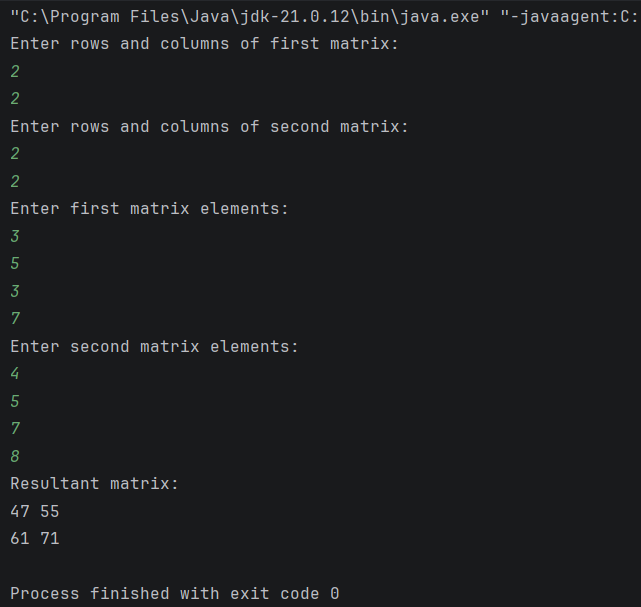

# Practical 01: Matrix Multiplication in Java

## Question
Write a Java program to perform multiplication of two matrices using `InputStreamReader` and `BufferedReader`.

## Technologies Used
- Java
- IntelliJ IDEA
- Java I/O

## Concepts Used
- Two-Dimensional Arrays
- Nested Loops
- InputStreamReader
- BufferedReader
- Matrix Multiplication

## Condition for Matrix Multiplication

Matrix multiplication is possible only when the number of columns in the first matrix is equal to the number of rows in the second matrix.

For example:

- First Matrix: 2 × 3
- Second Matrix: 3 × 2
- Resultant Matrix: 2 × 2

## How to Run (Using IntelliJ IDEA)

1. Open IntelliJ IDEA.
2. Open the Java project.
3. Navigate to `Practical-1`.
4. Open `MatrixMultiplication.java`.
5. Right-click inside the code editor.
6. Select **Run 'MatrixMultiplication.main()'**.
7. Enter the dimensions and elements of both matrices in the console.
8. View the resultant matrix.

## Expected Result

The program takes two matrices as input, checks whether multiplication is possible, and displays the resultant matrix.

If the multiplication condition is not satisfied, the program displays an appropriate message.

## Sample Output

