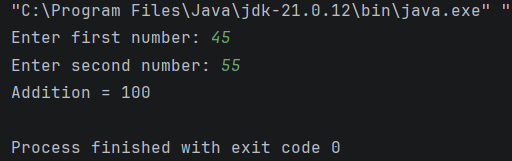

# Practical 10: Addition Using JavaBean

## Question
Write a program to create a bean component in Java for addition of two numbers.

## Technologies Used
- Java
- IntelliJ IDEA
- JavaBean

## Concepts Used
- JavaBean
- Serializable Interface
- Encapsulation
- Private Variables
- Getter and Setter Methods
- Object Creation
- Scanner Class
- Method Calling

## How to Run (Using IntelliJ IDEA)

1. Open IntelliJ IDEA.
2. Open the Java project.
3. Navigate to `Practical-10`.
4. Make sure both Java files are present:
   - `AdditionBean.java`
   - `AdditionDemo.java`
5. Open `AdditionDemo.java`.
6. Right-click inside the editor.
7. Select **Run 'AdditionDemo.main()'**.
8. Enter two numbers when prompted.
9. View the addition result.

## Expected Result

The program creates a JavaBean component to store two numbers. It uses setter methods to assign values and a getter method to calculate and return their sum.

## Sample Output

