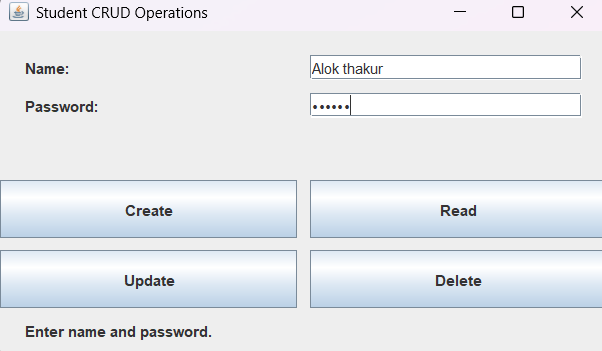
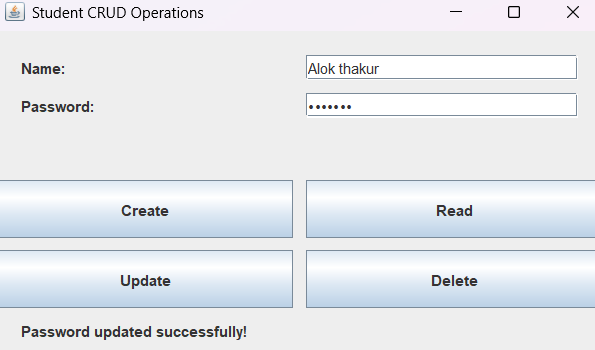

# Practical 12: CRUD Operations Using Java Swing

## Question
Reuse the above form to perform basic database operations (CRUD) using JDBC.

## Technologies Used
- Java
- IntelliJ IDEA
- Java Swing
- Java I/O

## Concepts Used
- JFrame
- JLabel
- JTextField
- JPasswordField
- JButton
- ActionListener
- Event Handling
- File Handling
- CSV File
- CRUD Operations
- Create, Read, Update and Delete

## How to Run (Using IntelliJ IDEA)

1. Open IntelliJ IDEA.
2. Open the Java project.
3. Navigate to `Practical-12`.
4. Open `StudentCRUD.java`.
5. Right-click inside the editor.
6. Select **Run 'StudentCRUD.main()'**.
7. Enter the student's name and password.
8. Use the Create, Read, Update and Delete buttons.
9. View the operation results.

## Expected Result

The program displays a student registration form using Java Swing. It performs basic CRUD operations (Create, Read, Update and Delete) and stores student records in a CSV file named `students.csv`.

## Sample Output

### Create Operation

### Update Operation

