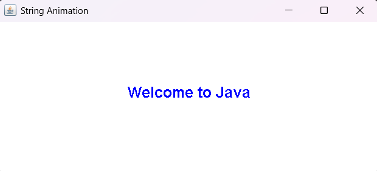

# Practical 02: String Animation Using Multithreading in Java

## Question
Write a program to animate a string on Applet. Use the concept of Multithreading.

## Technologies Used
- Java
- IntelliJ IDEA
- Java Swing

## Concepts Used
- Multithreading
- Thread Class
- Runnable Interface
- Swing Components
- Graphics Class
- Exception Handling
- Thread.sleep()

## How to Run (Using IntelliJ IDEA)

1. Open IntelliJ IDEA.
2. Open the Java project.
3. Navigate to `Practical-2`.
4. Open `StringAnimation.java`.
5. Right-click inside the editor.
6. Select **Run 'StringAnimation.main()'**.
7. View the animated string in the window.

## Expected Result

The program displays the string **"Welcome to Java"** in blue colour and animates it horizontally using multithreading.

## Sample Output

