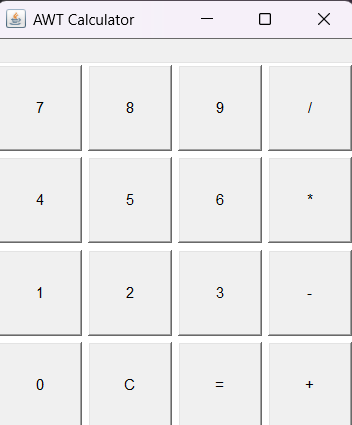

# Practical 03: Calculator Using Java AWT

## Question
Write a program to design a calculator using the AWT controls provided by Java.

## Technologies Used
- Java
- IntelliJ IDEA
- Java AWT

## Concepts Used
- AWT
- Frame
- TextField
- Button
- GridLayout
- ActionListener
- Event Handling
- Arithmetic Operations

## How to Run (Using IntelliJ IDEA)

1. Open IntelliJ IDEA.
2. Open the Java project.
3. Navigate to `Practical-3`.
4. Open `Calculator.java`.
5. Right-click inside the editor.
6. Select **Run 'Calculator.main()'**.
7. Use the calculator buttons to perform basic arithmetic operations.

## Expected Result

The program displays a calculator interface using Java AWT controls. It performs basic arithmetic operations such as addition, subtraction, multiplication and division.

## Sample Output

