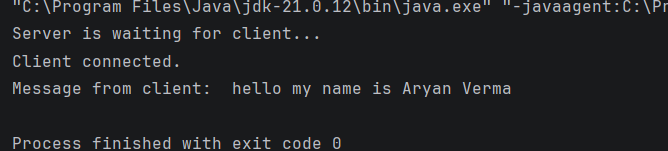
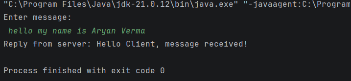

# Practical 04: Client-Server Communication Using TCP in Java

## Question
Write a program for Client-Server communication using either UDP or TCP protocols. Use ServerSocket and Socket classes.

## Technologies Used
- Java
- IntelliJ IDEA
- TCP/IP
- Java Networking

## Concepts Used
- Client-Server Architecture
- TCP Protocol
- Socket Programming
- ServerSocket
- Socket
- InputStream
- OutputStream
- BufferedReader
- PrintWriter

## How to Run (Using IntelliJ IDEA)

1. Open IntelliJ IDEA.
2. Open the Java project.
3. Navigate to `Practical-4`.
4. Open `MyServer.java`.
5. Right-click inside the editor.
6. Select **Run 'MyServer.main()'**.
7. Wait until the server starts and keep it running.
8. Open `MyClient.java`.
9. Right-click inside the editor and select **Run 'MyClient.main()'**.
10. Enter a message from the client.
11. View the server's response on the client side.

## Expected Result

The program establishes communication between a client and a server using the TCP protocol.

The client sends a message to the server, and the server receives the message and sends a response back to the client.

## Sample Output

### Server Output

### Client Output

