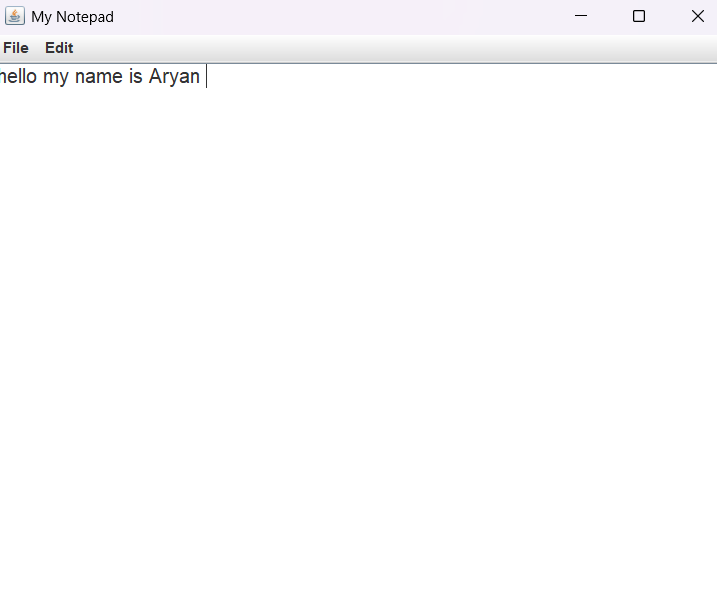

# Practical 05: Notepad Application Using Java Swing

## Question
Write a Java program to create a Notepad application using Java Swing with basic file handling and editing features.

## Technologies Used
- Java
- IntelliJ IDEA
- Java Swing
- Java I/O

## Concepts Used
- JFrame
- JTextArea
- JMenuBar
- JMenu
- JMenuItem
- JFileChooser
- ActionListener
- Event Handling
- File Handling
- Cut, Copy and Paste Operations

## How to Run (Using IntelliJ IDEA)

1. Open IntelliJ IDEA.
2. Open the Java project.
3. Navigate to `Practical-5`.
4. Open `Notepad.java`.
5. Right-click inside the code editor.
6. Select **Run 'Notepad.main()'**.
7. The Notepad application window will appear.
8. Use the File menu to create, open and save text files.
9. Use the Edit menu for Cut, Copy and Paste operations.

## Expected Result

The program displays a Notepad application with a text area and File and Edit menus.

It supports the following operations:
- New
- Open
- Save
- Save As
- Exit
- Cut
- Copy
- Paste

## Sample Output

