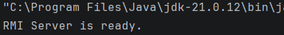
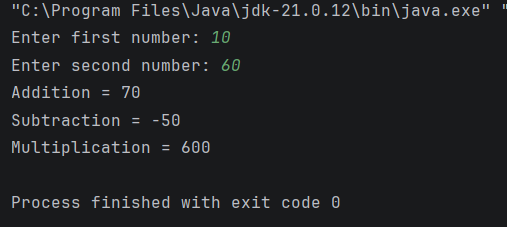

# Practical 06: Remote Method Invocation (RMI) in Java

## Question
Write a Java program to perform addition, subtraction and multiplication of two numbers using Remote Method Invocation (RMI).

## Technologies Used
- Java
- IntelliJ IDEA
- Java RMI
- Java Networking

## Concepts Used
- Remote Method Invocation (RMI)
- Client-Server Architecture
- Remote Interface
- Remote Object
- UnicastRemoteObject
- RMI Registry
- RemoteException
- Scanner Class

## How to Run (Using IntelliJ IDEA)

1. Open IntelliJ IDEA.
2. Open the Java project.
3. Navigate to `Practical-6`.
4. Make sure all four Java files are present:
   - `RemoteCalc.java`
   - `RemoteCalcImpl.java`
   - `RMIServer.java`
   - `RMIClient.java`
5. Run `RMIServer.java` first.
6. Wait until the message **"RMI Server is ready."** appears.
7. Keep the server running.
8. Open and run `RMIClient.java`.
9. Enter two numbers when prompted.
10. View the addition, subtraction and multiplication results.

## Expected Result

The program establishes communication between the RMI client and server.

The client sends two numbers to the remote server, which performs:
- Addition
- Subtraction
- Multiplication

The calculated results are returned and displayed on the client side.

## Sample Output

### Server Output

### Client Output

