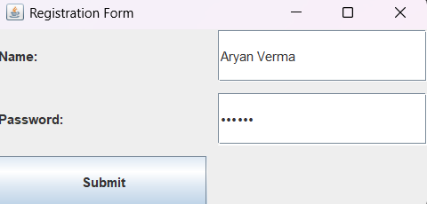

# Practical 07: Registration Form Using Java Swing

## Question
Create a form containing fields name and password respectively, using Applet as a container.

## Technologies Used
- Java
- IntelliJ IDEA
- Java Swing
- Java I/O

## Concepts Used
- JFrame
- JLabel
- JTextField
- JPasswordField
- JButton
- ActionListener
- Event Handling
- File Handling
- CSV File

## How to Run (Using IntelliJ IDEA)

1. Open IntelliJ IDEA.
2. Open the Java project.
3. Navigate to `Practical-7`.
4. Open `LoginPageN.java`.
5. Right-click inside the editor.
6. Select **Run 'LoginPageN.main()'**.
7. Enter your name and password in the form.
8. Click the Submit button.
9. View the confirmation message.

## Expected Result

The program displays a form containing Name and Password fields. When the user submits the form, the entered details are validated and stored in a CSV file named `users.csv`.

## Sample Output

