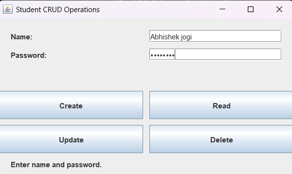

# Practical 09: Student Registration Portal Using Java Swing

## Question
Write a program to create a small portal which contains the registration form of students. Use JDBC.

## Technologies Used
- Java
- IntelliJ IDEA
- Java Swing
- Java I/O

## Concepts Used
- JFrame
- JLabel
- JTextField
- JPasswordField
- JButton
- ActionListener
- Event Handling
- File Handling
- CSV File
- CRUD Operations

## How to Run (Using IntelliJ IDEA)

1. Open IntelliJ IDEA.
2. Open the Java project.
3. Navigate to `Practical-9`.
4. Open `StudentRegistration.java`.
5. Right-click inside the editor.
6. Select **Run 'StudentRegistration.main()'**.
7. Enter the student's name and password.
8. Use the available buttons to create, read, update or delete records.
9. Check the stored records in `students.csv`.

## Expected Result

The program displays a student registration portal using Java Swing. It allows users to create, read, update and delete student records. The records are stored in a CSV file named `students.csv`.

## Sample Output

